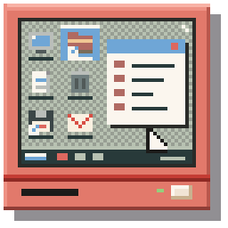

  

# Hide Icons Plus 

**Hide Icons Plus** is an enhanced fork of [emp0ry/Hide-Icons](https://github.com/emp0ry/Hide-Icons) — a lightweight Windows tray app to quickly show/hide desktop icons, set a global hotkey, control auto-start, and use a custom tray icon. Runs as a **standard user** (no admin required).

> All credit for the original app goes to **emp0ry**. This fork adds new features on top of it (see below).

## ✨ New in Hide-Icons-Plus

These features are **new in the Hide-Icons-Plus version** and do not exist in the original Hide Icons:

| Feature | Where | What it does |
|---|---|---|
| 🚀 **Hide on Exec** | Right-click tray icon → **Hide on Exec** (checkable) | When desktop icons are visible and you launch something from the desktop — by **double-clicking an icon** or pressing **Enter** on a selected one — the icons are hidden again automatically. |
| ⏱️ **Countdown Timer** | Right-click tray icon → **Timer** | Opens a small window where you tick **Countdown Timer** and choose a number of **Seconds** (default **30**). Whenever the icons are shown, they are hidden automatically once the time runs out. |
| 🪟 **Hide Windows** | Right-click tray icon → **Hide Windows** (checkable) | Works like **Win + D**: clicking the tray icon shows the desktop icons **and** minimizes all open windows. Click again to hide the icons and restore every window as it was. |
| ℹ️ **Redesigned About window** | Right-click tray icon → **About** | A clean, wide window showing the version and a one-line explanation of every menu option. |

### 🪟 Hide Windows
- Enable it from the tray menu; a ✔ appears next to **Hide Windows** while it is active.
- **Icons hidden → click:** icons appear and all windows are minimized (just like Win + D).
- **Icons visible → click:** icons are hidden and your windows are restored.
- Also applies to your global hotkey, which behaves the same as clicking the tray icon.
- Combines with **Timer**: when the countdown ends, icons are hidden and the windows come back.
- The setting is remembered between restarts.

### 🚀 Hide on Exec
- Enable it from the tray menu; a ✔ appears next to **Hide on Exec** while it is active.
- Double-clicking empty desktop space does **not** trigger it — only real icons do.
- Hiding happens a fraction of a second after the launch, so the program you started is never disturbed.
- The setting is remembered between restarts.

### ⏱️ Countdown Timer
- Open **Timer**, tick **Countdown Timer**, set the number of seconds (1–86400) and press **OK**.
- A ✔ appears next to **Timer** in the tray menu while the countdown is active.
- The countdown starts whenever the icons become visible — via tray click, hotkey, or the desktop's own context menu. If you hide them yourself, the countdown resets.
- Works together with **Hide on Exec**: whichever happens first hides the icons.
- Settings are remembered between restarts.

### ℹ️ About window
Shows the app version and credits at the top, followed by a short one-sentence description of each tray menu option (toggle, startup, icons, hotkey, Hide on Exec, Timer, Hide Windows, Exit).

### 🔄 Updates
The built-in auto-updater now checks **this repository's** [Releases](https://github.com/Thermoptic/Hide-Icons-Plus/releases), so you always get the Plus version.

## 🚀 Features (original + Plus)
- **One-click toggle** – Left-click the tray icon to show/hide desktop icons.
- **Hotkey support** – Assign your own shortcut for instant toggling.
- **Custom tray icon** – Load any `.ico`; auto-adapts to dark/light theme when using the default.
- **Run at startup** – Enable/disable auto-start with a click.
- **Persistent settings** – Your choices survive restarts.
- **Auto-update** – Checks and updates on app start.
- **Hide on Exec** *(new in Plus)* – Auto-hide icons after launching something from the desktop.
- **Countdown Timer** *(new in Plus)* – Auto-hide icons after a configurable number of seconds.
- **Hide Windows** *(new in Plus)* – Minimize/restore all windows together with the icons, like Win + D.
- **Redesigned About window** *(new in Plus)* – Version info plus a one-line explanation of every option.
- **No hacks** – Uses the desktop's own command (no poking SysListView32), works on Win10/11.

## 💻 System Requirements
- **Windows 10 22H2** or **Windows 11 23H2/24H2** (and newer)
- No administrator privileges needed

## 📸 Screenshots
|  |  |  |
|---|---|---|

## ⬇️ Install & Run
1. Download the latest release from [Releases](https://github.com/Thermoptic/Hide-Icons-Plus/releases).
2. Launch `HideIcons.exe`, and the tray icon appears in the notification area.
3. **Left-click** the tray icon to toggle icons, **right-click** for the menu.

> **Uninstall**: Exit the app and delete the files. If you enabled *Run at Startup*, toggle it off from the tray menu before removing.

## 🧭 Usage
- **Toggle icons**: Left-click the tray icon.
- **Set hotkey**: Right-click → **Set Hotkey** → choose a shortcut.
Remove it with the **Remove Hotkey** button inside the same window.
- **Auto-start**: Right-click → **Run at Startup**.
- **Custom icon**: Right-click → **Change Icon** → **Browse** for an `.ico` file (the path is shown next to the button) → **Apply**, or press **Reset Icon** in the same window to restore the default.
- **Hide on Exec** *(Plus)*: Right-click → **Hide on Exec**.
- **Countdown Timer** *(Plus)*: Right-click → **Timer** → tick **Countdown Timer** → set seconds → **OK**.
- **Hide Windows** *(Plus)*: Right-click → **Hide Windows**.

## 🤝 Contributing
Issues and PRs are welcome! Please describe the environment (Windows version, steps to reproduce) when filing bugs.

## ☕ Donation
If you find this useful:

## 📄 License
MIT License. See [LICENSE](LICENSE.txt) for details.

## Website

The [product website](https://hideicons.emp0ry.com/) is also available at [emp0ry.com/Hide-Icons/](https://emp0ry.com/Hide-Icons/). Website sources and publication are maintained in the private emp0ry.com project. Completed application releases notify its central static build; this repository contains the application and its technical documentation.
